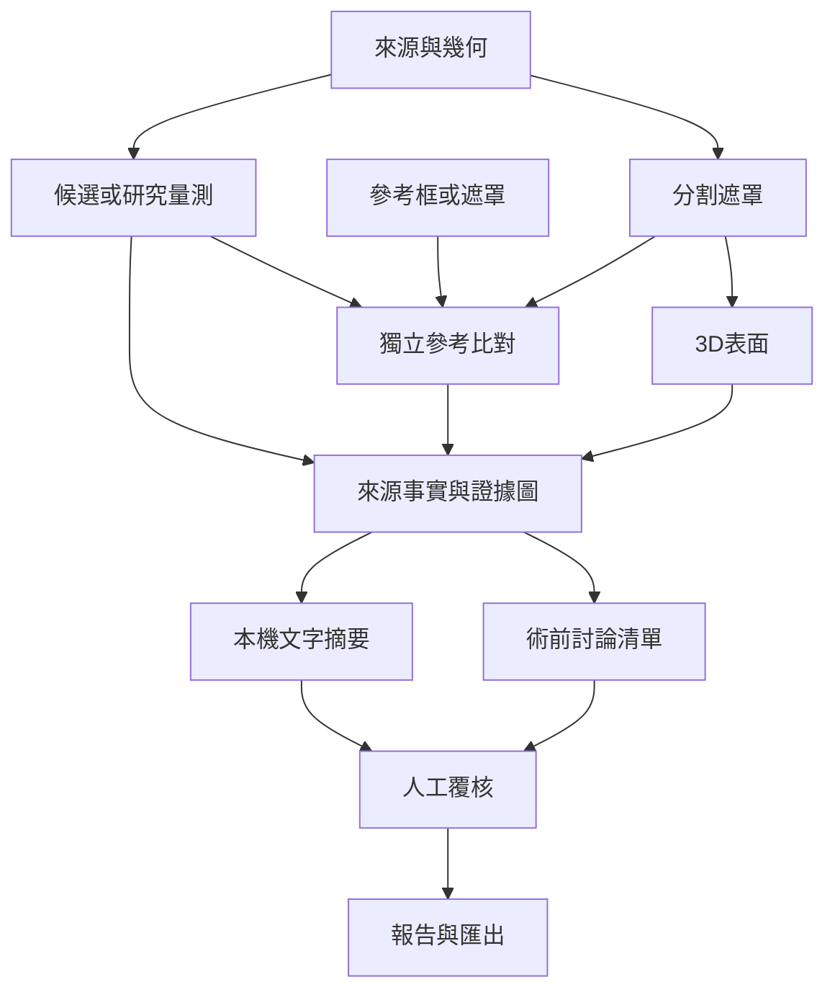

# CardioAgent 整合分析方法與證據定義

本文件對應 v2 的可執行流程，說明輸入、分析階段、量測、來源圖與覆核。研究原稿的精度、既有工作站軟體測試數與本版實際結果分開管理；本次執行的數字以 evidence 下的整合結果及驗證檔案為準。

## 輸入與資料來源

每筆分析保存病例識別、影像類型、切片數與尺寸、來源像素 SHA256、中心切片、模式、閾值及可用空間幾何。demo 只接受 synthetic=true 的資料；model 依登錄權重與模型契約執行；inspect 提供可重現量測及閾值預覽，不產生冠狀動脈 CT 模型結果。

DICOM 匯入僅保留分析所需的最小幾何欄位及雜湊後的序列關聯識別，不能依上傳檔名推斷切片順序。完整位置與方向成立時依法向投影排序，並檢查同序列、座標系、正交方向、重複位置與間距一致性。否則幾何狀態為未驗證，單位保留為 voxel。

## 執行與持久化

圖中箭頭表示資料與證據依賴，不表示各階段平行執行；參考資料只進入比對。每個階段保存狀態、實際耗時與受阻理由。缺少 CT 權重時，辨識階段不以合成結果接續；仍可執行的獨立量測保留其來源與限制。LLM 文字是獨立結果，不覆寫原始事實、量測與人工欄位。慢速模型等待不應占用急性流程的全域鎖。

分析紀錄保存至本機資料目錄，使用伺服器產生的識別碼及版本。人工核准或退回須核對目前版本；已覆核紀錄不能被下游文字或新的討論內容靜默覆寫。報告簽核與分析覆核保持獨立。

## 候選及影像解釋

現有 ST-CAC 契約採 2.5D：以前、中、後切片為三通道，輸入為 float32 `[1,3,512,512]`，像素除以 255。輸出 `[1,5,N]` 表示 xywh 與單類 confidence，經門檻與 NMS 產生像素候選。model 結果保存已登錄模型及 SHA256；登錄者聲明的 trained 欄位不代表本平台重新驗證臨床效能。

解釋列出候選、座標、切片、引擎、門檻及資料狀態，目的是說明可追溯依據。它沒有利用模型梯度或擾動實驗，因此不能稱為 Grad-CAM、SHAP 或因果解釋。

## 參考框比對

候選框與參考框以 IoU 配對：

$$\operatorname{IoU}(A,B)=\frac{|A\cap B|}{|A\cup B|}.$$

在指定 IoU 門檻下採一對一配對。匹配數為 TP；未匹配候選為 FP；未匹配參考為 FN。

$$\operatorname{Precision}=\frac{TP}{TP+FP},\qquad \operatorname{Recall}=\frac{TP}{TP+FN},\qquad F_1=\frac{2TP}{2TP+FP+FN}.$$

只在與候選產生程序分開提供的參考可用時顯示上述值。分母為零時應保留定義及空值狀態，不能任意補成完美表現。合成單例及切片級結果不等於獨立病人級效能。

## 已登錄分割模型

可選用逐切片 ONNX 解剖分割路徑，固定 float32 `[1,1,H,W]` 輸入與 `[1,C,H,W]` logits 輸出。模型登錄需提供 modality、input_size、class_labels、target_class、window、來源聲明及 SHA256。前處理以宣告的窗值裁切及正規化，不進行隱含縮放；輸出依類別選取目標遮罩。未提供有效權重或契約不符時停止此階段，不改用閾值冒充。

模型登錄及零輸入契約試跑只驗證可載入、形狀及數值，不代表分割效能。獨立參考遮罩僅進入評估，不能用來產生候選、選閾值或重建。模型推論與閾值模式的來源必須在畫面及匯出紀錄中分開。

## 原檔提供的研究標籤

第三種分割來源為 `provided_reference`，使用已與來源影像核對的原始 HDF5 `label`。操作代碼 0 選取所有非零標籤的聯集；代碼 1、2、3 分別取對應原檔標籤。這一路徑不進行模型推論，也不稱為模型辨識結果。代碼不自動對應特定心室或心肌，因為本次來源沒有可核對的類別名稱及標註者資訊。

此標籤是參考重建網格的直接輸入，故不能再用同一標籤當成獨立真值評估該重建的 Dice。閾值或模型產生的遮罩與原檔標籤分開時，可計算重疊一致性，但需標示為提供研究標籤的比較；本次沒有經臨床驗證的真值。來源沒有驗證間距時，保留 voxel 座標及標籤體素數，物理體積為空值。

## 遮罩比對及體積

強度閾值或模型產生前景遮罩 P；與該方法分開提供的參考遮罩為 G。兩者尺寸、目標及空間一致時，才計算：

$$\operatorname{Dice}(P,G)=\frac{2|P\cap G|}{|P|+|G|}.$$

兩遮罩皆空時，程式約定 Dice 與 IoU 為 1，並另存 `both_empty=true`；這不表示成功辨認任何解剖結構。比對前仍須確認兩者表示相同目標區域及空間。

物理幾何成立時，以原始前景體素數量 N 計算離散體積：

$$V=N\,\Delta x\,\Delta y\,\Delta z.$$

物理體積不由降採樣網格的外觀或三角面數推定。內附體模的間距為合成定義，並非病人掃描標定。對間距未知的 ACDC MRI，輸出體素數及 voxel 座標，物理體積保留空值。

## 表面還原與空間座標

重建使用二值體素邊界表面，透過上限採樣控制網格大小。原始量測與預覽網格分開保存。DICOM 幾何完整時，依 origin、direction 及 spacing 將體素座標轉為 LPS 空間；未知幾何使用體素索引。此演算法沒有自動完成解剖器官辨識、血管中心線、血流或心動週期重建。

OBJ 與 STL 的匯出附來源與單位說明；STL 在其他軟體中的預設單位未必一致，需配合分析 JSON 核對。門檻造成的表面、封閉邊界與粗網格不能直接用於手術切除、導航、植入物或器械路徑。

## 分析間比較

既有分析比較須核對病例與來源影像雜湊。相同影像下的候選、閾值或體積差異可用於方法與參數敏感度分析；沒有配準、標定與臨床時間點資料時，不輸出疾病惡化或改善的判斷。提供的 ACDC 研究標籤可供重疊一致性比照，但其類別映射、標註者及臨床驗證狀態未由來源屬性確立。

## 本機語言模型

LLM 只整理已驗證的合成流程事實，並保存實際模型、後端、回應識別與耗時；未符合本機、下載及用途條件時拒絕呼叫。結構、來源識別或服務異常採明示規則接續。影像候選及報告欄位依來源事實產生，模型摘要另存待人工核對。

## 術前討論方法

討論模組採三態人工核對欄位：是、否、未知。欄位涵蓋急性警訊、解剖、缺血、左心室功能、風險、藥物與偏好等資料。輸出分為優先處理、資料不完整或可供 MDT 討論，不產生 approved_for_surgery。

一般醫療選項說明引用 2021 ACC/AHA/SCAI 血運重建指引與 2024 ESC 慢性冠心症指引。來源摘要提供可回查連結及版本；本模組沒有把這些指引轉成自動 CABG 或 PCI 適應症規則。是否治療及治療方式需依完整臨床證據與專業團隊共同決策。

## 本次真實 MRI 參考比照

原檔提供類別 1、2、3 的體素數分別為 26,474、25,573、23,799，聯集共 75,846。直接使用聯集重建得到 2,412 個三角面，方法為 provided_research_labels，不執行模型，單位為 voxel，mm³ 及自我比對 Dice 均為空值。

閾值 T=128 的 MRI 前景為 295,603 體素，與該來源標籤聯集的交集為 33,708 體素，Dice=0.181495、IoU=0.099804。兩者使用同一來源像素但以不同程序產生，故可作研究重疊一致性比較。由於類別映射、標註者及模型訓練資料的獨立性未確認，這不是獨立臨床測試集效能。

此負向基準保留原結果，不能透過把參考標籤直接作輸入而宣稱閾值或模型改善為 Dice=1。新分割模型須另外記錄權重、前處理、目標類別與資料切分，才能建立有意義的效能比較。實際輸出見 evidence/integrated_sample_results.json 與 mri_provided_reference_analysis.json。

## 驗證層次

| 層次 | 能回答的問題 | 不能推定的內容 |
|---|---|---|
| 單元與狀態測試 | 格式、順序、版本、權限、錯誤分支是否正確 | 真實臨床準確度 |
| 真實 HTTP 與 DOM | 瀏覽介面操作是否能正確讀寫後端 | Canvas 或 3D GPU 視覺正確性 |
| 合成體模 | 已知幾何、遮罩、網格、單位及匯出計算是否一致 | 病人解剖可還原度 |
| 真實 MRI 量測 | 來源像素及數值流程可否重現 | CT 鈣化辨識與病人毫米尺度 |
| 提供研究標籤重建 | 原檔標籤及參考表面的來源、體素數和重疊一致性 | 已訓練分割模型的效能或未驗證的器官類別 |
| 真實模型及標註測試 | 專用模型在獨立資料的準確度 | 未測設備與未測族群的效能 |
| AMD 實機驗收 | 實際裝置、分派、延遲、記憶體及離線冷啟動 | 自動取得醫院互通或臨床核准 |

## 參考來源

1. ACC/AHA/SCAI. 2021 Guideline for Coronary Artery Revascularization. https://www.jacc.org/doi/full/10.1016/j.jacc.2021.09.006
2. ESC. 2024 Guidelines for the management of chronic coronary syndromes. https://www.escardio.org/guidelines/clinical-practice-guidelines/all-esc-practice-guidelines/chronic-coronary-syndromes/
3. 使用者 ACDC 來源及轉換記錄：assets/mri/meta.json。
4. AHA. 2025 Coronary Artery Revascularization in the Older Adult Population 科學聲明。https://doi.org/10.1161/CIR.0000000000001387
5. DICOM PS3.3 2026d. C.7.6.2 Image Plane Module。https://dicom.nema.org/medical/dicom/current/output/chtml/part03/sect_C.7.6.2.html
6. ONNX Runtime. Python 官方文件。https://onnxruntime.ai/docs/get-started/with-python.html
7. 本版程式及實際驗證：cardio/analysis.py、cardio/volume.py、cardio/segmentation.py、cardio/discussion.py 與 evidence/。
